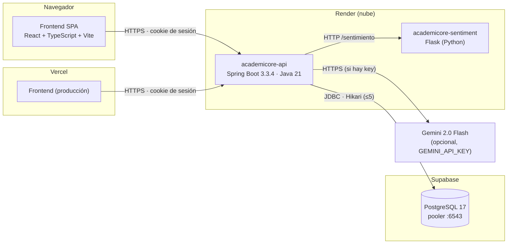
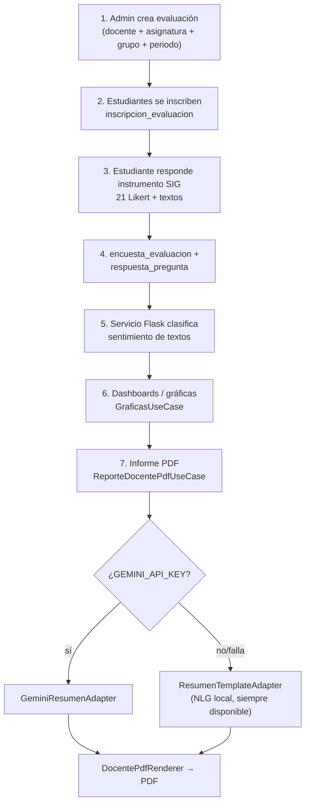

# Arquitectura del sistema — academiCORE

## 1. Visión general

academiCORE es una plataforma académica cuyo módulo principal activo es la
**evaluación docente por percepción estudiantil**, basada en el instrumento
oficial **SIG** de la Universidad de Cartagena (21 preguntas Likert 1–4 +
preguntas de texto). Conserva además los módulos de pénsum, admisiones, pagos
y campus construidos previamente.



## 2. Stack tecnológico

| Capa | Tecnología |
|---|---|
| Backend | Java 21 · Spring Boot 3.3.4 · Maven |
| Persistencia | Spring Data JPA (Hibernate) · Flyway (15 migraciones) |
| Base de datos | PostgreSQL 17 en Supabase — **pooler de transacción :6543** |
| Documentos | OpenPDF 1.3.30 (reportes PDF del docente) |
| IA / NLP | Adaptador Gemini (opcional) + NLG local en español (fallback) |
| Sentimiento | Microservicio Flask propio (`academicore-sentiment`) |
| Frontend | React 18 · TypeScript · Vite · nginx (contenedor) |
| Despliegue | Render Blueprint (`render.yaml`) · Vercel · Docker Compose local |
| Auth | Sesión por cookie `academicore_session` (SameSite=None, Secure, HttpOnly, 15 días) |

## 3. Estilo arquitectónico: hexagonal (puertos y adaptadores)

Cada módulo sigue la misma estructura de 4 capas:

```
com.academicore.<modulo>
├── domain/                  ← núcleo: reglas de negocio puras (sin Spring)
│   ├── model/               entidades de dominio + enums de estado
│   ├── repository/          PUERTOS (interfaces) de persistencia/integración
│   └── exception/           excepciones de negocio
├── application/             ← casos de uso (orquestación)
│   ├── usecase/             una clase por caso de uso
│   └── dto/                 request/response de la API
├── infrastructure/          ← ADAPTADORES (implementan los puertos)
│   ├── persistence/
│   │   ├── entity/          entidades JPA (tablas)
│   │   ├── repository/      Spring Data JpaRepository
│   │   ├── mapper/          MapStruct entity ↔ dominio
│   │   └── adapter/         *RepositoryAdapter implementa el puerto
│   ├── ia/                  adaptadores de resumen (Gemini / template local)
│   ├── pdf/                 DocentePdfRenderer (OpenPDF)
│   └── sentiment/           cliente HTTP al microservicio Flask
└── presentation/rest/       ← controladores REST (/api/...)
```

**Regla de dependencias:** `presentation → application → domain ← infrastructure`.
El dominio nunca importa de Spring ni de JPA; la infraestructura implementa los
puertos que el dominio define — se puede cambiar de BD, de IA o de generador de
PDF sin tocar la lógica de negocio.

## 4. Módulos

| Módulo | Responsabilidad | Controlador principal |
|---|---|---|
| `auth` | Login, sesiones, roles (ADMIN/ESTUDIANTE/DOCENTE), listado de usuarios | `AuthController` |
| `evaluacion` | **Núcleo**: instrumento SIG, encuestas, respuestas, gráficas, reportes PDF, resumen IA | `EvaluacionDocenteController` |
| `pensum` | Universidad → facultad → departamento → programa → plan → malla curricular | `PensumController` |
| `admisiones` | Periodos, ofertas, aspirantes, inscripciones, documentos | `AdmisionesController`, `AspirantesController` |
| `pagos` | Monedas, conceptos, facturas de inscripción | `PagosController` |
| `campus` | Sedes e imágenes institucionales | `CampusController` |
| `config` | CORS, beans transversales | — |
| `common` | Excepciones/handlers compartidos | — |

## 5. Flujo del dominio principal: evaluación docente



Casos de uso clave en `evaluacion/application/usecase/`:

- `GraficasUseCase` — radar por categoría, comparativo por materia, evolución
  por periodo, sentimiento, fortalezas/oportunidades, nube de palabras.
- `DocenteReporteUseCase` — comentarios agrupados por evaluación/materia/grupo.
- `ReporteDocentePdfUseCase` — orquesta los dos anteriores + `ResumenDocentePort`
  + `DocentePdfRenderer` → bytes del PDF.

Puerto `ResumenDocentePort` (dominio) con dos adaptadores intercambiables:
`GeminiResumenAdapter` (solo si `GEMINI_API_KEY` está definida) y
`ResumenTemplateAdapter` (local, español formal, sin límites).

## 6. Seguridad y sesiones

- `POST /api/auth/login` valida credenciales (hash), crea fila en `sesion`
  (token + expiración 15 días) y devuelve cookie `academicore_session`.
- Cookie `SameSite=None; Secure; HttpOnly` → funciona cross-site
  (localhost:5173/3002 → Render; Vercel → Render).
- Filtro de sesión resuelve `usuario` por token en cada request; expira por BD.
- CORS (`CorsConfig`): `allowedOriginPatterns` — localhost/127.0.0.1 en
  **cualquier puerto** siempre permitido; `CORS_ALLOWED_ORIGINS` suma dominios
  (Vercel, previews).

## 7. Despliegue y topología

| Componente | Producción | Local |
|---|---|---|
| Frontend | Vercel (`VITE_API_URL` → Render) | `docker compose` → nginx :3002 · Vite dev :5173 (proxy → :8081) |
| API | Render `academicore-api` (free tier, duerme; el front hace ping/splash hasta despertarlo) | Docker :8081 (interno :8080) |
| Sentimiento | Render `academicore-sentiment` | Docker :5000 |
| BD | Supabase `zxgrpzbunghncopuhiea` — pooler transacción `aws-1-us-east-1.pooler.supabase.com:6543` | misma Supabase, o Postgres local (`--profile localdb`) |

**Restricciones operativas relevantes:**

- El pooler de **sesión** de Supabase gratis admite solo 15 clientes → la app
  usa el de **transacción :6543** (sin límite práctico) y Hikari queda
  limitado a 5 (Render) / 4 (local) vía `SPRING_DATASOURCE_HIKARI_MAXIMUM_POOL_SIZE`.
- `DB_URL` incluye `prepareThreshold=0` (requisito del modo transacción).
- Migraciones Flyway validadas contra el mismo pooler (V1–V15 al día).
- Secretos en Render (`sync:false` en `render.yaml`): `DB_PASSWORD`,
  `SUPABASE_SERVICE_KEY`, `GEMINI_API_KEY` (opcional).

## 8. Endpoints principales

```
POST /api/auth/login · POST /api/auth/logout · GET /api/auth/me
GET  /api/auth/usuarios

GET  /api/v1/evaluacion-docente/... (instrumento, pendientes, respuestas)
GET  /api/v1/evaluacion-docente/docentes/{id}/graficas[?asignaturaId]
GET  /api/v1/evaluacion-docente/docentes/{id}/reporte[?asignaturaId]
GET  /api/v1/evaluacion-docente/docentes/{id}/reporte/pdf[?asignaturaId]   ← informe PDF

GET  /api/pensum/... · /api/admisiones/... · /api/pagos/... · /api/campus/...
GET  /api/health
```
