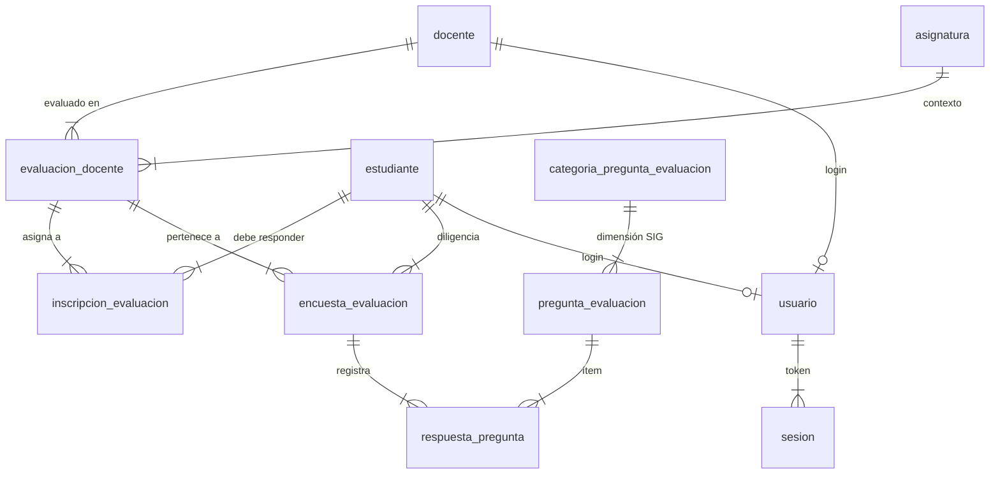

# Modelo de datos — academiCORE

PostgreSQL 17 (Supabase, esquema `public`) · **36 tablas** de negocio +
`flyway_schema_history` (control de migraciones) · 47 llaves foráneas.

## 1. Diagrama entidad-relación completo

```mermaid
erDiagram
    universidad ||--|{ facultad : "agrupa"
    universidad ||--|{ campus : "tiene sedes"
    facultad ||--|{ departamento_academico : "contiene"
    facultad ||--|{ programa_academico : "ofrece"
    programa_academico ||--|{ programa_campus : "se dicta en"
    campus ||--|{ programa_campus : "aloja"
    departamento_academico ||--|{ asignatura : "dicta"
    departamento_academico ||--|{ docente : "adscrito"
    programa_academico ||--|{ plan_estudios : "versiona"
    periodicidad_academica ||--|{ plan_estudios : "rige"
    plan_estudios ||--|{ nivel_curricular : "define niveles"
    plan_estudios ||--|{ plan_asignatura : "malla"
    asignatura ||--|{ plan_asignatura : "ubicada en"
    nivel_curricular ||--|{ plan_asignatura : "nivel"
    tipo_asignatura_plan ||--|{ plan_asignatura : "tipifica"
    plan_asignatura ||--|{ requisito_plan_asignatura : "tiene requisitos"
    plan_asignatura ||--|{ requisito_plan_asignatura : "es requisito de"
    tipo_requisito ||--|{ requisito_plan_asignatura : "tipifica"
    asignatura ||--|{ asignatura_naturaleza : "caracteriza"
    naturaleza_asignatura ||--|{ asignatura_naturaleza : "caracteriza"
    programa_academico ||--|{ estudiante : "matricula"
    plan_estudios ||--|{ estudiante : "cursa"
    periodo_admision ||--|{ oferta_admision : "publica"
    programa_academico ||--|{ oferta_admision : "ofertado"
    plan_estudios ||--|{ oferta_admision : "pensum"
    campus ||--|{ oferta_admision : "sede"
    moneda ||--|{ oferta_admision : "tarifa"
    aspirante ||--|{ inscripcion : "se inscribe"
    oferta_admision ||--|{ inscripcion : "recibe"
    inscripcion ||--|{ documento_aspirante : "soporta"
    inscripcion ||--|{ factura : "genera"
    concepto_pago ||--|{ factura : "concepto"
    moneda ||--|{ factura : "moneda"
    docente ||--|{ evaluacion_docente : "es evaluado"
    asignatura ||--|{ evaluacion_docente : "en materia"
    programa_academico ||--|{ evaluacion_docente : "programa"
    evaluacion_docente ||--|{ inscripcion_evaluacion : "convoca"
    estudiante ||--|{ inscripcion_evaluacion : "asignado"
    evaluacion_docente ||--|{ encuesta_evaluacion : "recoge"
    estudiante ||--|{ encuesta_evaluacion : "responde"
    encuesta_evaluacion ||--|{ respuesta_pregunta : "contiene"
    pregunta_evaluacion ||--|{ respuesta_pregunta : "respondida"
    categoria_pregunta_evaluacion ||--|{ pregunta_evaluacion : "agrupa"
    estudiante ||--o| usuario : "vinculado"
    docente ||--o| usuario : "vinculado"
    usuario ||--|{ sesion : "autentica"
    campus ||--|{ imagen_campus : "galería"
    categoria_imagen_campus ||--|{ imagen_campus : "categoría"

    universidad { bigint id PK  varchar codigo UK  varchar nombre  date fecha_creacion  varchar estado }
    facultad { bigint id PK  bigint universidad_id FK  varchar codigo  varchar nombre  varchar estado }
    departamento_academico { bigint id PK  bigint facultad_id FK  varchar codigo  varchar nombre  varchar estado }
    programa_academico { bigint id PK  bigint facultad_id FK  varchar codigo_interno  varchar codigo_snies  varchar nombre  int creditos_totales  varchar estado }
    campus { bigint id PK  bigint universidad_id FK  varchar codigo  varchar nombre  varchar direccion  varchar ciudad  text descripcion  bool es_sede_principal  int orden  varchar url_mapa  varchar estado }
    programa_campus { bigint programa_id PK-FK  bigint campus_id PK-FK  varchar estado }
    asignatura { bigint id PK  bigint departamento_id FK  varchar codigo  varchar nombre  text descripcion  varchar estado }
    periodicidad_academica { bigint id PK  varchar codigo UK  varchar nombre  int duracion_meses }
    plan_estudios { bigint id PK  bigint programa_id FK  bigint periodicidad_id FK  varchar codigo_pensum  varchar nombre  varchar numero_resolucion  date fecha_vigencia_desde  date fecha_vigencia_hasta  int total_creditos  varchar estado }
    nivel_curricular { bigint id PK  bigint plan_estudios_id FK  int numero_nivel  varchar nombre }
    plan_asignatura { bigint id PK  bigint plan_estudios_id FK  bigint asignatura_id FK  bigint nivel_curricular_id FK  bigint tipo_asignatura_id FK  numeric creditos  numeric horas_docencia_semanales  bool es_habilitable }
    tipo_asignatura_plan { bigint id PK  varchar codigo UK  varchar nombre }
    requisito_plan_asignatura { bigint id PK  bigint plan_estudios_id FK  bigint plan_asignatura_id FK  bigint plan_asignatura_requerida_id FK  bigint tipo_requisito_id FK }
    tipo_requisito { bigint id PK  varchar codigo UK  varchar nombre }
    naturaleza_asignatura { bigint id PK  varchar codigo UK  varchar nombre  varchar descripcion }
    asignatura_naturaleza { bigint asignatura_id PK-FK  bigint naturaleza_id PK-FK }
    estudiante { bigint id PK  varchar numero_documento UK  varchar nombres  varchar apellidos  varchar email  varchar codigo UK  varchar sexo  varchar telefono  varchar direccion  bigint programa_id FK  int semestre  varchar estado_academico  varchar estado_ingreso  bigint plan_estudios_id FK  varchar estado }
    docente { bigint id PK  varchar numero_documento UK  varchar nombres  varchar apellidos  varchar email  varchar sexo  varchar telefono  varchar direccion  varchar tipo_vinculacion  varchar escalafon  varchar nivel_formacion  bigint departamento_id FK  date fecha_ingreso  varchar estado }
    usuario { bigint id PK  varchar username UK  varchar password_hash  varchar rol  varchar nombre_mostrar  bigint estudiante_id FK  bigint docente_id FK  varchar estado  timestamptz ultimo_acceso  timestamptz creado_en }
    sesion { bigint id PK  varchar token UK  bigint usuario_id FK  timestamptz creado_en  timestamptz expira_en }
    evaluacion_docente { bigint id PK  bigint docente_id FK  bigint asignatura_id FK  bigint programa_id FK  varchar grupo  varchar periodo  int estudiantes_esperados  varchar estado  timestamp fecha_creacion }
    inscripcion_evaluacion { bigint id PK  bigint evaluacion_id FK  bigint estudiante_id FK  timestamp fecha_inscripcion }
    encuesta_evaluacion { bigint id PK  bigint evaluacion_id FK  bigint estudiante_id FK  timestamp fecha_respuesta }
    categoria_pregunta_evaluacion { bigint id PK  varchar codigo UK  varchar nombre  int orden }
    pregunta_evaluacion { bigint id PK  bigint categoria_id FK  int numero  varchar texto  varchar estado  varchar tipo }
    respuesta_pregunta { bigint id PK  bigint encuesta_id FK  bigint pregunta_id FK  int valor  text texto_respuesta  varchar sentimiento  float8 sentimiento_score  varchar sentimiento_metodo }
    periodo_admision { bigint id PK  varchar codigo UK  varchar nombre  date fecha_inicio_inscripciones  date fecha_fin_inscripciones  date fecha_inicio_clases  varchar estado }
    oferta_admision { bigint id PK  bigint periodo_admision_id FK  bigint programa_id FK  bigint plan_estudios_id FK  bigint campus_id FK  int cupos_totales  int cupos_disponibles  numeric valor_inscripcion  bigint moneda_id FK  varchar estado }
    aspirante { bigint id PK  varchar tipo_documento  varchar numero_documento  varchar nombres  varchar apellidos  varchar email  varchar telefono  date fecha_nacimiento  timestamp fecha_registro  varchar estado }
    inscripcion { bigint id PK  bigint aspirante_id FK  bigint oferta_admision_id FK  timestamp fecha_inscripcion  varchar estado  text observaciones }
    documento_aspirante { bigint id PK  bigint inscripcion_id FK  varchar tipo_documento  varchar url  timestamp fecha_carga  varchar estado }
    moneda { bigint id PK  varchar codigo_iso UK  varchar nombre  varchar simbolo }
    concepto_pago { bigint id PK  varchar codigo UK  varchar nombre }
    factura { bigint id PK  bigint inscripcion_id FK  bigint concepto_pago_id FK  bigint moneda_id FK  varchar numero_factura UK  numeric valor  timestamp fecha_emision  timestamp fecha_vencimiento  varchar estado }
    categoria_imagen_campus { bigint id PK  varchar codigo UK  varchar nombre }
    imagen_campus { bigint id PK  bigint campus_id FK  bigint categoria_id FK  varchar url  varchar descripcion  int orden  timestamp fecha_carga  varchar estado }
```

## 2. Diagrama del núcleo funcional: evaluación docente



**Cadena de datos:** `evaluacion_docente` (qué se evalúa: docente+materia+grupo+periodo)
→ `inscripcion_evaluacion` (quiénes deben responderla)
→ `encuesta_evaluacion` (la respuesta diligenciada)
→ `respuesta_pregunta` (una fila por ítem: número Likert o texto + sentimiento).

## 3. Catálogo de tablas por dominio

### 3.1 Estructura académica (`pensum`)

| Tabla | Descripción / claves notables |
|---|---|
| `universidad` | Institución raíz. UK `codigo` |
| `facultad` | Facultades por universidad. UK `(universidad_id, codigo)` y `(universidad_id, nombre)` |
| `departamento_academico` | Departamentos por facultad. UK `(facultad_id, codigo)` |
| `programa_academico` | Carreras (con `codigo_snies`, `creditos_totales`) |
| `campus` | Sedes físicas (ciudad, dirección, sede principal, mapa) |
| `programa_campus` | N:M programa↔sede. PK compuesta |
| `asignatura` | Materias del departamento. UK `(departamento_id, codigo)` |
| `periodicidad_academica` | Semestre/trimestre (`duracion_meses`) |
| `plan_estudios` | Pénsum versionado por resolución y vigencia. Estado `EN_DISENO→VIGENTE` |
| `nivel_curricular` | Niveles/semestres del plan. UK `(plan_estudios_id, numero_nivel)` |
| `plan_asignatura` | Materia dentro de la malla: nivel, tipo, créditos, horas |
| `tipo_asignatura_plan` | Catálogo: obligatoria, electiva, etc. |
| `requisito_plan_asignatura` | Prerrequisitos entre materias del plan (FK compuesta) |
| `tipo_requisito` | Catálogo: prerrequisito, correquisito |
| `naturaleza_asignatura` + `asignatura_naturaleza` | Naturaleza N:M de cada materia (teórica, práctica…) |

### 3.2 Personas y autenticación (`auth`)

| Tabla | Descripción |
|---|---|
| `estudiante` | Ficha SIA: `codigo` UK, documento UK, programa, semestre, `estado_academico` (NORMAL/RIESGO_ACADEMICO/…), plan |
| `docente` | `numero_documento` UK, vinculación (PLANTA_TIEMPO_COMPLETO/…), escalafón (AUXILIAR→TITULAR), formación, departamento |
| `usuario` | `username`+`password_hash`, rol `ADMIN/ESTUDIANTE/DOCENTE`, FK opcional a `estudiante` **o** `docente`, estado |
| `sesion` | Token de sesión UK, expiración; alimenta la cookie `academicore_session` |

### 3.3 Evaluación docente (`evaluacion`) — dominio activo

| Tabla | Descripción |
|---|---|
| `evaluacion_docente` | Convocatoria: docente + asignatura + grupo + `periodo`. UK `(docente_id, asignatura_id, grupo, periodo)`. Estado ABIERTA/CERRADA |
| `inscripcion_evaluacion` | Asignación estudiante↔evaluación (las 6 por estudiante del dataset). UK `(evaluacion_id, estudiante_id)` |
| `encuesta_evaluacion` | Una respuesta diligenciada por estudiante/evaluación. UK `(evaluacion_id, estudiante_id)` |
| `categoria_pregunta_evaluacion` | Dimensiones del instrumento SIG |
| `pregunta_evaluacion` | Ítems: `numero`, `texto`, `tipo` LIKERT/TEXTO, `estado` ACTIVA/INACTIVA (21 activas SIG + 5 inactivas legado) |
| `respuesta_pregunta` | Respuesta por ítem: `valor` 1–5, `texto_respuesta`, y análisis de sentimiento (`POSITIVO/NEGATIVO/NEUTRO`, `score`, `metodo` MODELO/LEXICO). CHECK: al menos `valor` **o** `texto_respuesta` |

### 3.4 Admisiones (`admisiones`)

| Tabla | Descripción |
|---|---|
| `periodo_admision` | Convocatoria con fechas. Estado PROGRAMADO→… |
| `oferta_admision` | Programa+plan+sede publicado: cupos, `valor_inscripcion`, moneda. UK `(periodo, programa, campus)` |
| `aspirante` | Datos del aspirante. UK `(tipo_documento, numero_documento)` |
| `inscripcion` | Aspirante a una oferta. UK `(aspirante_id, oferta_admision_id)`. Estado `PENDIENTE_PAGO→…` |
| `documento_aspirante` | Soportes por inscripción (url, tipo, estado) |

### 3.5 Pagos (`pagos`)

| Tabla | Descripción |
|---|---|
| `moneda` | `codigo_iso`, símbolo |
| `concepto_pago` | Catálogo (inscripción, matrícula…) |
| `factura` | Ligada a inscripción: `numero_factura` UK, valor, vencimiento, estado `PENDIENTE/…` |

### 3.6 Multimedia (`campus`)

| Tabla | Descripción |
|---|---|
| `categoria_imagen_campus` | Categorías de la galería |
| `imagen_campus` | Fotos por sede: `url` (hoy servidas desde el front `/campus/…`), orden, estado |

## 4. Reglas de negocio en el esquema

- **Checks de estado**: casi todas las tablas llevan `CHECK` con el catálogo de
  valores válidos (roles, estados, tipos) → la BD es la última línea de defensa.
- **Unicidad semántica**: las UK compuestas impiden duplicados funcionales —
  un docente no puede tener dos evaluaciones de la misma materia+grupo+periodo
  (`uq_evaluacion_docente_materia`), ni un estudiante responder dos veces la
  misma evaluación (`uq_encuesta_evaluacion_estudiante`).
- **Claves compuestas**: `plan_asignatura`/`nivel_curricular` se referencian con
  FK de dos columnas (`plan_estudios_id, id`) para garantizar consistencia
  intra-plan en requisitos.
- `respuesta_pregunta.valor` admite 1–5 aunque el SIG activo usa 1–4
  (compatibilidad con el formato anterior, preguntas INACTIVA).
- El sentimiento lo calcula el microservicio Flask (`metodo=MODELO`) o un
  léxico local de respaldo (`metodo=LEXICO`).

## 5. Dataset demo actual (Supabase)

| Entidad | Cantidad |
|---|---|
| Usuarios | 11 (1 admin, 6 estudiantes, 4 docentes) |
| Asignaturas / Docentes / Estudiantes | 6 / 4 / 6 |
| Evaluaciones docente | 6 |
| Inscripciones de evaluación | 36 (6 por estudiante) |
| Encuestas respondidas | 12 (2 por estudiante → 6 por docente evaluado) |
| Respuestas de preguntas | 252 |
| Preguntas SIG activas / legado inactivas | 21 / 5 |
